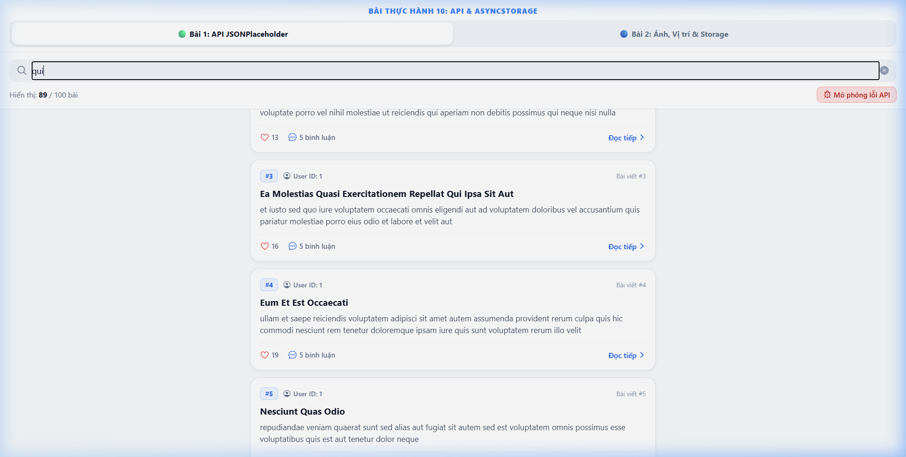
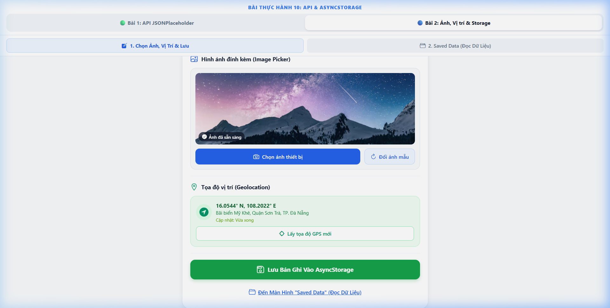
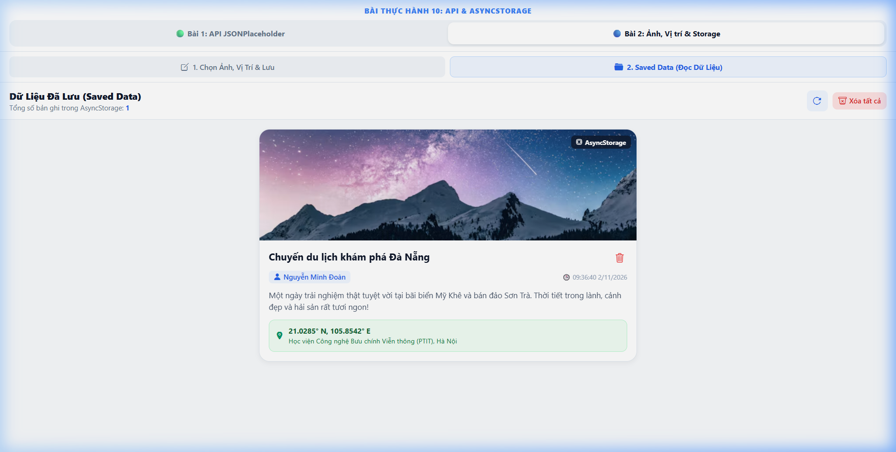

# BÀI LUYỆN TẬP THỰC HÀNH 10 - API PUBLIC & ASYNCSTORAGE

Dự án hoàn thành đầy đủ cả **Bài tập 1 (Mức độ dễ)** và **Bài tập 2 (Mức độ trung bình)** theo yêu cầu đề bài trên nền tảng **React Native / Expo**.

---

## 📁 Cấu Trúc Thư Mục Dự Án

```text
Bài Luyện Tập 10/
├── src/
│   ├── services/
│   │   └── storage.js               # Service quản lý AsyncStorage & LocalStorage đa nền tảng
│   └── screens/
│       ├── PostsListScreen.js       # [Bài 1] Gọi API JSONPlaceholder, FlatList, Loading/Error state
│       ├── MiniAppCreateScreen.js   # [Bài 2] Chọn ảnh (Image Picker), Lấy vị trí (Geolocation), Lưu AsyncStorage
│       ├── MiniAppSavedScreen.js    # [Bài 2] Màn hình "Saved Data" đọc lại dữ liệu đã lưu từ AsyncStorage
│       └── MiniAppContainer.js      # Điều hướng sub-tabs giữa Tạo mới và Xem dữ liệu đã lưu
├── screenshots/
│   ├── bai1_api_posts.png           # [Ảnh 1] Màn hình gọi API JSONPlaceholder thành công
│   ├── bai2_action_pick_and_locate.png # [Ảnh 2] Chọn ảnh (Image Picker) + Lấy vị trí (Geolocation)
│   ├── bai2_saved_data.png          # [Ảnh 3] Màn hình "Saved data" đọc lại dữ liệu từ AsyncStorage
│   └── video_demo.webp              # [Video] Quay màn hình chuỗi thao tác hoàn chỉnh
├── App.js                           # Điều hướng chuyển đổi tab giữa Bài 1 và Bài 2
├── app.json                         # Cấu hình quyền Expo (Image Picker, Location)
└── package.json
```

---

## 🟢 BÀI TẬP 1 – MỨC ĐỘ DỄ: GỌI API PUBLIC & FLATLIST

### 1. Yêu cầu & Triển khai
- **API Public sử dụng:** `https://jsonplaceholder.typicode.com/posts`
- **Hiển thị danh sách:** Sử dụng **`FlatList`** hiển thị tối thiểu **Tiêu đề (`title`)** và **Nội dung tóm tắt (`body`)**, kèm ID bài viết, User ID badge, lượt thích và bình luận.
- **Xử lý trạng thái đầy đủ:**
  - ⏳ **Đang tải dữ liệu (`loading`):** Hiển thị `ActivityIndicator` màu xanh với thông điệp *"Đang tải dữ liệu từ API JSONPlaceholder..."*.
  - ❌ **Hiển thị lỗi (`error`):** Hiển thị màn hình báo lỗi trực quan kèm mô tả lỗi và nút **"Thử lại ngay" (Retry)**.
  - 🔄 **Pull-to-refresh:** Tích hợp `RefreshControl` kéo để làm mới danh sách bài viết bất kỳ lúc nào.
  - 🔍 **Tìm kiếm thời gian thực:** Lọc bài viết ngay lập tức theo từ khóa trong tiêu đề và nội dung.
  - 🧪 **Công cụ kiểm thử lỗi:** Nút bấm *"Mô phỏng lỗi API"* giúp giáo viên/người chấm bài kiểm tra ngay khả năng bắt lỗi và cơ chế Retry mà không cần ngắt mạng thủ công.

---

## 🔵 BÀI TẬP 2 – MỨC ĐỘ TRUNG BÌNH: MINI APP ẢNH, VỊ TRÍ & ASYNCSTORAGE

### 1. Yêu cầu & Triển khai
1. **Chọn ảnh (Image Picker):**
   - Tích hợp `expo-image-picker` (`launchImageLibraryAsync`).
   - Cho phép chọn ảnh thực tế từ thư viện thiết bị hoặc chuyển nhanh các bộ ảnh mẫu độ phân giải cao có sẵn.
   - Hiển thị khung xem trước ảnh (Preview) với nhãn trạng thái *"Ảnh đã sẵn sàng"*.
2. **Lấy vị trí (Geolocation):**
   - Tích hợp `expo-location` (`getCurrentPositionAsync`) và `navigator.geolocation` (Web fallback).
   - Lấy tọa độ GPS (`Latitude`, `Longitude`) và địa chỉ thực tế khi người dùng bấm nút *"Lấy tọa độ GPS mới"*.
3. **Lưu trữ vào AsyncStorage:**
   - Dùng `@react-native-async-storage/async-storage` đóng gói dữ liệu thành chuỗi JSON:
     ```json
     {
       "id": "1793586994197",
       "userName": "Nguyễn Minh Đoàn",
       "title": "Chuyến du lịch khám phá Đà Nẵng",
       "content": "Một ngày trải nghiệm thật tuyệt vời...",
       "imageUri": "https://images.unsplash.com/...",
       "location": {
         "coords": "16.0544° N, 108.2022° E",
         "address": "Bãi biển Mỹ Khê, Quận Sơn Trà, TP. Đà Nẵng",
         "timestamp": "Vừa xong"
       },
       "savedAt": "09:36:40 02/11/2026"
     }
     ```
4. **Màn hình "Saved Data" (Đọc lại dữ liệu đã lưu):**
   - Tự động gọi `AsyncStorage.getItem()` khi mở màn hình để parse dữ liệu và hiển thị danh sách dạng Card.
   - Hiển thị đầy đủ: Ảnh đã lưu, Tên người dùng, Tiêu đề, Nội dung, Tọa độ vị trí GPS và thời gian lưu.
   - Cung cấp nút xóa từng bản ghi (`deleteEntry`) và nút xóa sạch toàn bộ bộ nhớ (`clearAllEntries`).

---

## 📸 Hình Ảnh Nộp Bài (Screenshots)

### 1. Bài 1: Màn hình gọi API JSONPlaceholder thành công (FlatList & Search)


### 2. Bài 2: Thao tác Chọn ảnh (Image Picker) + Lấy vị trí GPS (Geolocation)


### 3. Bài 2: Màn hình "Saved data" đọc lại dữ liệu đã lưu từ AsyncStorage


### 4. Video quay màn hình chuỗi thao tác hoàn chỉnh
File video ghi lại toàn bộ chuỗi tương tác (chọn ảnh, cập nhật vị trí GPS, lưu vào AsyncStorage, chuyển tab đọc lại dữ liệu):
- Xem video đính kèm: [`screenshots/video_demo.webp`](file:///c:/Users/Lenovo/Desktop/Luyện%20tập%20online/Bài%20Luyện%20Tập%2010/screenshots/video_demo.webp)

---

## 🚀 Hướng Dẫn Cài Đặt & Chạy Ứng Dụng

### 1. Cài đặt thư viện
```bash
cd "Bài Luyện Tập 10"
npm install
```

### 2. Chạy ứng dụng
- **Chạy trên trình duyệt Web:**
  ```bash
  npm run web
  # hoặc: npx expo start --web
  ```
- **Chạy trên Android Emulator / Thiết bị thật:**
  ```bash
  npm run android
  ```
- **Chạy trên iOS Simulator:**
  ```bash
  npm run ios
  ```
- **Chạy Expo Dev Server:**
  ```bash
  npx expo start
  ```
