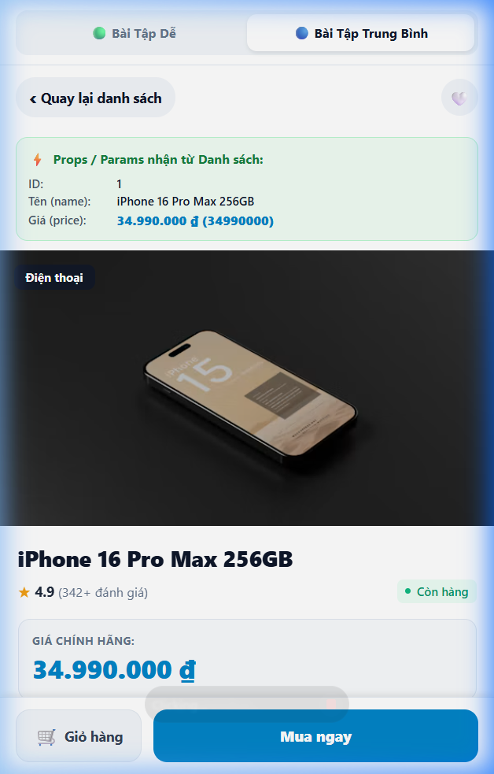
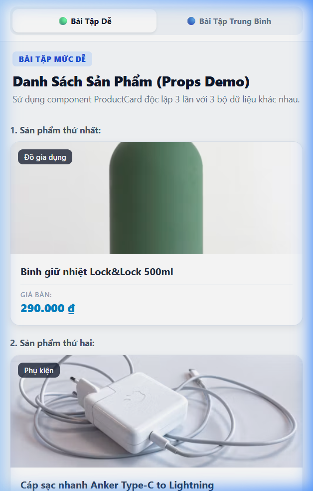

# BÀI LUYỆN TẬP THỰC HÀNH 8 - REACT NATIVE

Dự án hoàn thành đầy đủ cả **Bài tập mức dễ** và **Bài tập mức trung bình** theo yêu cầu, xây dựng trên nền tảng **React Native / Expo**.

---

## 📁 Cấu Trúc Dự Án

```text
├── src/
│   ├── components/
│   │   └── ProductCard.js         # Component ProductCard nhận props name, price (tái sử dụng nhiều lần)
│   ├── data/
│   │   └── products.js            # Mock data 10 sản phẩm (Bài trung bình) + 3 sản phẩm mẫu (Bài dễ)
│   └── screens/
│       ├── EasyExerciseScreen.js  # Màn hình Bài Dễ: 3 thẻ sản phẩm độc lập + giải thích lý thuyết
│       ├── ProductListScreen.js   # Màn hình Bài Trung Bình: FlatList 10 sản phẩm + tìm kiếm, lọc danh mục
│       └── ProductDetailScreen.js # Màn hình Detail: nhận id, name, price, specs... + nút quay lại
├── screenshots/
│   ├── product_list_screen.png    # Ảnh chụp màn hình Product List (FlatList)
│   ├── product_detail_screen.png  # Ảnh chụp màn hình Product Detail
│   └── easy_exercise_screen.png   # Ảnh chụp màn hình Bài tập Dễ
├── App.js                         # Điều phối điều hướng chuyển tab giữa 2 bài tập
└── package.json
```

---

## 🟢 BÀI TẬP MỨC DỄ

### 1. Yêu cầu & Triển khai
- **Tạo component `ProductCard` riêng biệt** (`src/components/ProductCard.js`):
  - Nhận props bắt buộc: `name` (tên sản phẩm) và `price` (giá sản phẩm).
  - Tùy chọn mở rộng: `image`, `category`, `rating`, `onPress`.
  - Bố cục dạng thẻ (Card) chuẩn với hiệu ứng bo góc, đổ bóng (`shadow` trên iOS, `elevation` trên Android).
- **Import và sử dụng ít nhất 3 lần**:
  - Tại file `src/screens/EasyExerciseScreen.js`, component `ProductCard` được render 3 lần độc lập với 3 bộ dữ liệu khác nhau:
    1. *Bình giữ nhiệt Lock&Lock 500ml* - Giá: `290.000 ₫`
    2. *Cáp sạc nhanh Anker Type-C to Lightning* - Giá: `180.000 ₫`
    3. *Sạc dự phòng Baseus 20.000mAh 65W* - Giá: `750.000 ₫`

### 2. Đoạn giải thích lý thuyết theo yêu cầu đề bài

> **a. Cách Props được truyền từ component cha xuống component con:**
> - Trong React Native, dữ liệu được truyền theo luồng một chiều từ trên xuống (*One-Way Data Flow*).
> - Component cha (`EasyExerciseScreen`) truyền dữ liệu xuống component con (`ProductCard`) thông qua các thuộc tính (props) bằng cú pháp tương tự thuộc tính HTML:
>   ```jsx
>   <ProductCard name="Bình giữ nhiệt Lock&Lock" price={290000} />
>   ```
> - Tại component con (`ProductCard`), React đóng gói toàn bộ các thuộc tính này vào một đối tượng JavaScript duy nhất (props object) làm tham số đầu vào. Ta dùng kỹ thuật Destructuring `{ name, price }` để lấy dữ liệu ra và render lên các component giao diện cơ bản (`<Text>`, `<View>`).
> - **Lưu ý quan trọng:** Props trong React là **Read-Only (bất biến)**, component con không được phép chỉnh sửa giá trị trực tiếp của props nhận từ cha.
>
> **b. Vì sao component `ProductCard` có thể tái sử dụng nhiều lần?**
> - **Tách biệt Giao diện và Dữ liệu (Separation of UI and Data):** `ProductCard` chỉ định nghĩa bộ khung hiển thị (khung card, kích thước, bo góc, màu sắc, kiểu font), nó hoàn toàn độc lập và không bị gắn cứng dữ liệu cụ thể nào.
> - **Tính linh hoạt:** Mỗi lần component được gọi với một cặp giá trị `name` và `price` khác nhau, nó sẽ hiển thị một sản phẩm mới mà vẫn đảm bảo tính đồng nhất 100% về mặt thiết kế của toàn ứng dụng.
> - **Dễ bảo trì và mở rộng (Maintainability):** Khi cần thay đổi phong cách hiển thị (đổi màu viền, tăng kích thước font, thay đổi định dạng tiền tệ), lập trình viên chỉ cần sửa đúng 1 file `ProductCard.js`, toàn bộ các màn hình đang sử dụng thẻ này đều tự động được cập nhật.

---

## 🔵 BÀI TẬP MỨC TRUNG BÌNH

### 1. Yêu cầu & Triển khai
- **Mock data 10 sản phẩm** (`src/data/products.js`):
  - Gồm đầy đủ các trường: `id`, `name`, `price`, `formattedPrice`, `category`, `rating`, `reviewsCount`, `image`, `description`, `specs`.
- **Màn hình Product List** (`src/screens/ProductListScreen.js`):
  - Sử dụng **`FlatList`** với `data`, `keyExtractor` và `renderItem`.
  - Tích hợp ô tìm kiếm theo tên và thanh lọc danh mục sản phẩm mượt mà.
  - Bấm vào bất kỳ thẻ sản phẩm nào sẽ kích hoạt sự kiện chuyển sang màn hình Detail.
- **Màn hình Product Detail** (`src/screens/ProductDetailScreen.js`):
  - Nhận các props/params từ màn hình danh sách: `id`, `name`, `price`, cùng với `image`, `specs`, `description`.
  - Hiển thị khối **"Props / Params nhận từ Danh sách"** giúp người chấm / giáo viên quan sát trực tiếp các giá trị đã truyền sang.
  - Có nút **"Quay lại danh sách"** (Back navigation) cùng các nút tương tác mua hàng, chọn số lượng.

---

## 📸 Hình Ảnh Nộp Bài (Screenshots)

| Màn hình Danh sách (FlatList - 10 SP) | Màn hình Chi tiết (Detail Params) | Màn hình Bài Dễ (3 Thẻ + Lý thuyết) |
| :---: | :---: | :---: |
|  |  |  |

---

## 🚀 Hướng Dẫn Cài Đặt & Chạy Ứng Dụng

### 1. Cài đặt thư viện
```bash
npm install
```

### 2. Chạy ứng dụng trên máy thật / giả lập / web
- **Chạy Expo Dev Server:**
  ```bash
  npx expo start
  ```
- **Chạy trên trình duyệt Web:**
  ```bash
  npx expo start --web
  # hoặc
  npm run web
  ```
- **Chạy trên Android:**
  ```bash
  npm run android
  ```
- **Chạy trên iOS:**
  ```bash
  npm run ios
  ```
