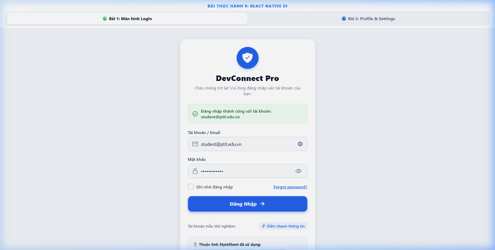
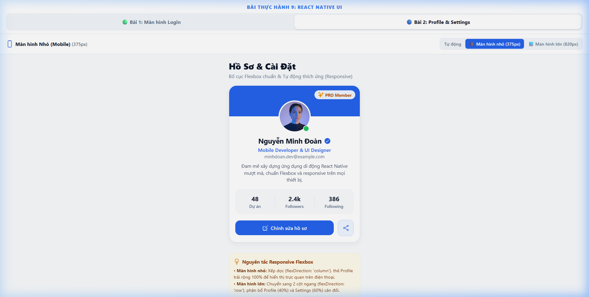
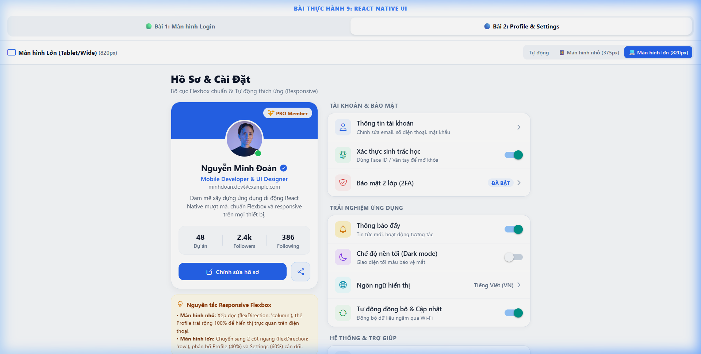

# BÀI LUYỆN TẬP THỰC HÀNH 9 - REACT NATIVE UI & STYLESHEET

Dự án hoàn thành đầy đủ cả **Bài tập 1 (Mức dễ)** và **Bài tập 2 (Mức trung bình)** theo đúng yêu cầu đề bài, áp dụng chuẩn **StyleSheet**, **Flexbox Layout** và kỹ thuật **Responsive đa nền tảng** trên **React Native / Expo**.

---

## 📁 Cấu Trúc Thư Mục Dự Án

```text
Bài Luyện Tập 9/
├── src/
│   ├── components/
│   │   ├── ProfileCard.js          # Component thẻ hồ sơ cá nhân (Avatar, Info, Stats, Action Buttons)
│   │   ├── SettingItem.js          # Component từng mục cài đặt (Icon, Title, Subtitle, Switch/Badge/Chevron)
│   │   └── SettingSection.js       # Component nhóm cài đặt theo chủ đề
│   └── screens/
│       ├── LoginScreen.js          # Màn hình Bài tập 1 (Login chuẩn StyleSheet)
│       └── ProfileSettingsScreen.js# Màn hình Bài tập 2 (Profile Card + Settings List Responsive)
├── screenshots/
│   ├── bai1_login_screen.png       # Ảnh chụp màn hình Login (Bài 1)
│   ├── bai2_small_screen.png       # Ảnh chụp màn hình Bài 2 kích thước nhỏ (Mobile ~375px)
│   └── bai2_large_screen.png       # Ảnh chụp màn hình Bài 2 kích thước lớn (Tablet/Wide ~820px)
├── App.js                          # Điều hướng chuyển đổi tab giữa Bài 1 và Bài 2
├── app.json                        # Cấu hình Expo project
└── package.json
```

---

## 🟢 BÀI TẬP 1 – MỨC DỄ: MÀN HÌNH LOGIN

### 1. Yêu cầu & Kết quả đạt được
- **Tiêu đề ứng dụng:** `DevConnect Pro` kèm icon huy hiệu bảo mật và dòng mô tả phụ.
- **Hai ô nhập thông tin:**
  - Ô 1: Nhập Email / Tên đăng nhập (kèm icon `mail`, placeholder, nút xóa nhanh).
  - Ô 2: Nhập Mật khẩu (kèm icon `lock`, tính năng ẩn/hiện mật khẩu qua `secureTextEntry`).
- **Nút đăng nhập:** Nút `Đăng Nhập` bo tròn nổi bật, hiệu ứng đổ bóng `shadow` / `elevation`, phản hồi trạng thái xác thực.
- **Dòng chữ "Forgot password?":** Cho phép người dùng bấm vào để kích hoạt thông báo khôi phục mật khẩu.
- **Tuân thủ Styling:** 100% style chính được gom gọn gàng trong `StyleSheet.create()`, không dùng inline style tràn lan.

### 2. Bảng đối chiếu các thuộc tính StyleSheet cơ bản theo yêu cầu đề bài

| STT | Thuộc tính StyleSheet | Vị trí áp dụng trong mã nguồn | Mục đích sử dụng |
| :---: | :--- | :--- | :--- |
| **1** | `backgroundColor` | `styles.keyboardContainer`, `styles.cardContainer`, `styles.logoBadge`, `styles.loginButton` | Thiết lập màu nền trang, màu nền thẻ card, màu nền nút đăng nhập |
| **2** | `fontSize` | `styles.appTitle` (24px), `styles.loginButtonText` (15px), `styles.textInput` (14px) | Điều chỉnh kích thước chữ cho tiêu đề, nút bấm, ô nhập liệu |
| **3** | `fontWeight` | `styles.appTitle` ('800'), `styles.loginButtonText` ('700'), `styles.inputLabel` ('600') | Định độ đậm nhạt của chữ, tạo phân cấp thị giác rõ ràng |
| **4** | `padding` | `styles.scrollContent`, `styles.cardContainer` (24px), `styles.loginButton` (14px) | Tạo khoảng đệm khoảng cách an toàn bên trong component |
| **5** | `margin` | `styles.headerBox` (marginBottom: 24), `styles.inputGroup` (marginBottom: 16) | Tạo khoảng cách giữa các khối thành phần tách biệt nhau |
| **6** | `borderWidth` | `styles.cardContainer` (1px), `styles.inputWrapper` (1.5px), `styles.checkbox` | Tạo độ dày cho đường viền của card, input và checkbox |
| **7** | `borderRadius` | `styles.cardContainer` (20px), `styles.logoBadge` (34px tròn), `styles.loginButton` (12px) | Bo tròn các góc cạnh giúp giao diện mềm mại, hiện đại |
| **8** | `justifyContent` | `styles.scrollContent` ('center'), `styles.optionsRow` ('space-between'), `styles.loginButton` ('center') | Căn chỉnh các phần tử con theo trục chính (Main Axis) |
| **9** | `alignItems` | `styles.scrollContent` ('center'), `styles.inputWrapper` ('center'), `styles.loginButton` ('center') | Căn chỉnh các phần tử con theo trục phụ (Cross Axis) |

---

## 🔵 BÀI TẬP 2 – MỨC TRUNG BÌNH: CLONE UI "PROFILE CARD" + "SETTINGS LIST" (RESPONSIVE)

### 1. Phân tích kiến trúc Flexbox & Responsive
- **Bố cục Flexbox chuẩn:**
  - `ProfileCard.js`: Sử dụng `flexDirection: 'row'` cho dòng thông số thống kê (`Dự án`, `Followers`, `Following`) với `justifyContent: 'space-around'`, `alignItems: 'center'` và `flex: 1` cho từng cột con.
  - `SettingItem.js`: Căn ngang chuẩn `flexDirection: 'row'`, icon bo tròn bên trái, phần text co giãn tự động `flex: 1`, điều khiển (`Switch` / `Badge` / `Chevron`) nằm thẳng hàng bên phải.
  - `SettingSection.js`: Phân nhóm rõ ràng theo `Tài khoản & Bảo mật`, `Trải nghiệm ứng dụng`, `Hệ thống & Trợ giúp`.
- **Kỹ thuật Responsive:**
  - Sử dụng hook **`useWindowDimensions()`** lấy độ rộng màn hình thực tế.
  - Breakpoint được thiết lập tại `680px`:
    - **Màn hình nhỏ (Mobile < 680px, vd: 375px):** Áp dụng `flexDirection: 'column'`. Thẻ Profile hiển thị bên trên (chiều rộng 100%), Settings list cuộn bên dưới.
    - **Màn hình lớn (Tablet / Landscape / Desktop >= 680px, vd: 820px):** Áp dụng `flexDirection: 'row'`. Bố cục 2 cột song song (Profile Card chiếm ~40% bên trái, Settings List chiếm ~60% bên phải).
  - Tích hợp sẵn thanh công cụ mô phỏng kích thước: Cho phép người dùng chuyển nhanh giữa **Tự động**, **Màn hình nhỏ (375px)** và **Màn hình lớn (820px)** để xem và kiểm tra trực quan.

---

## 📸 Hình Ảnh Nộp Bài (Screenshots)

### 1. Bài tập 1: Màn hình Login


### 2. Bài tập 2: Màn hình nhỏ (Mobile ~375px)


### 3. Bài tập 2: Màn hình lớn (Tablet/Wide ~820px - Bố cục 2 cột song song)


---

## 🚀 Hướng Dẫn Cài Đặt & Khởi Chạy

### 1. Cài đặt dependencies
```bash
cd "Bài Luyện Tập 9"
npm install
```

### 2. Chạy ứng dụng
- **Chạy trên trình duyệt Web:**
  ```bash
  npm run web
  # hoặc: npx expo start --web
  ```
- **Chạy trên Android Emulator / Thiết bị Android:**
  ```bash
  npm run android
  ```
- **Chạy trên iOS Simulator:**
  ```bash
  npm run ios
  ```
- **Chạy giao diện tổng quát (Expo Dev Menu):**
  ```bash
  npx expo start
  ```
